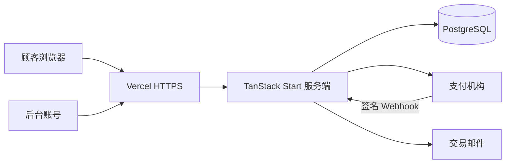

# 架构、选型与风险

## 选型

| 项 | 决定 | 原因 |
| --- | --- | --- |
| 界面 | 继续 React + TypeScript | 已经在用，不必为了文档里的 Next.js 重写 |
| 服务端 | 继续 TanStack Start 的服务端函数 | 前后端边界已经分开。密钥只留在服务端 |
| 数据库 | 第一期改为托管 PostgreSQL | 现有 SQL 就是 Postgres。临时库不能当生产账本 |
| 认证 | 继续 Better Auth，补管理员 MFA | 已有邮箱密码和角色。不把密钥放到浏览器 |
| 支付 | 审查通过后再选一家可收款的机构 | 现在没有真实扣款 |
| 部署 | 继续 Vercel | 项目 mu 已在上面。Cloudflare 需要自有域名，现在没有 |
| 版本 | GitHub `luckylynn230821-lgtm/orris` | 已在使用 |

不采用现成电商后端的原因：订单、库存和退款已经按这套账本写好，并有口径测试。第一期接支付和正式数据库，不把账本换成另一套产品。

## 环境

- 开发：本地预览，可用临时库。
- 预发布：单独的 Vercel 环境和单独的数据库，禁止指向生产库。
- 生产：只接受经过构建的发布。禁止在生产库里手改订单。

## 风险

- 线上现在仍是函数内临时库，冷启动会丢掉订单。这是上线前的阻断项。
- 免费 Vercel 没有完整 WAF。没有自有域名就接不上 Cloudflare。
- 演示结账如果没关掉就接入真实支付，会把样品单变成真收款。
- 店名 MU 尚未做商标检索。
