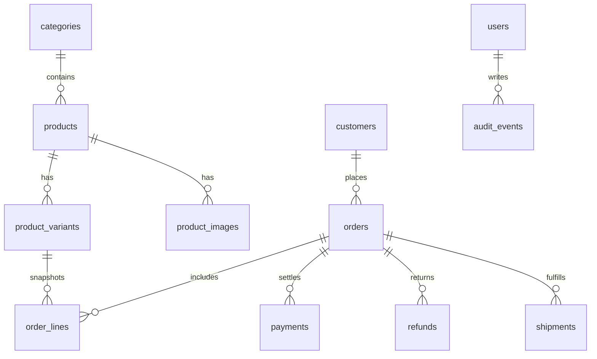

# 数据库草案

金额用整数美分。订单保存下单时的单价和成本，之后改价不回写旧订单。

现有表：`store_settings`、`categories`、`products`、`product_variants`、`product_images`、`customers`、`orders`、订单行、库存流水、物流和税率。结构变更只走 `migrations/`。

## 第一期新增

- `payments`：支付机构、外部单号、金额、状态、签名校验时间。唯一约束防止重复入账。
- `refunds`：关联订单和支付，记录金额、是否回库、操作者。
- `audit_events`：谁、何时、对哪张单、做了什么。只追加，不提供前台删除。
- `support_notes`：客服备注，仅后台可见。

## 不做

不把卡号、完整支付密钥写入这些表。密钥只放在部署环境变量。
